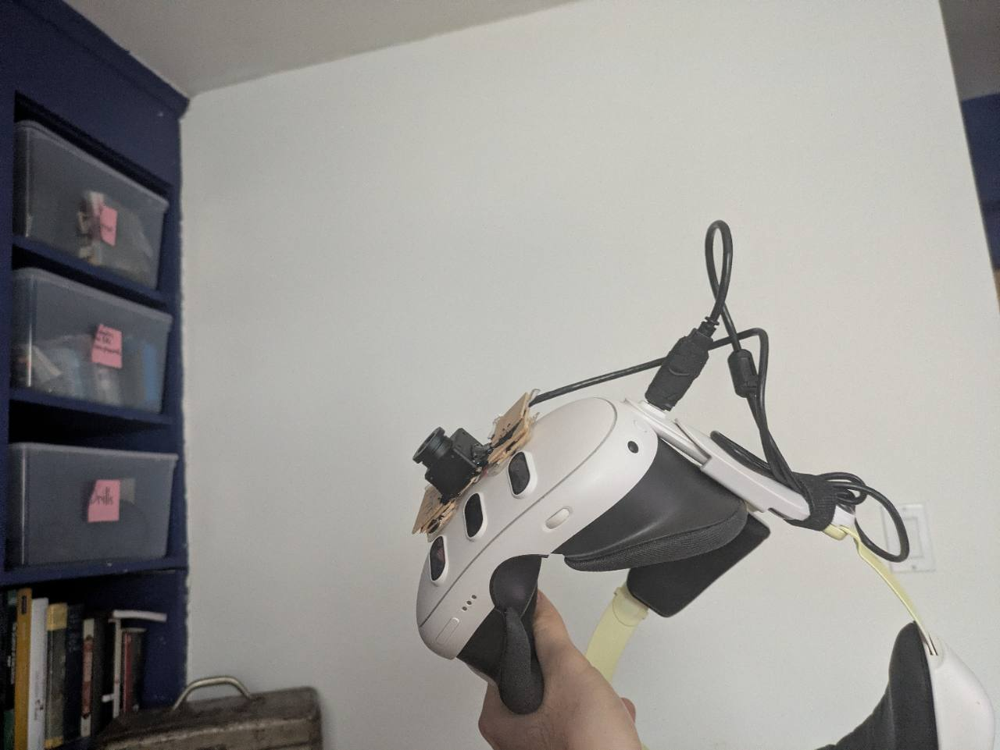
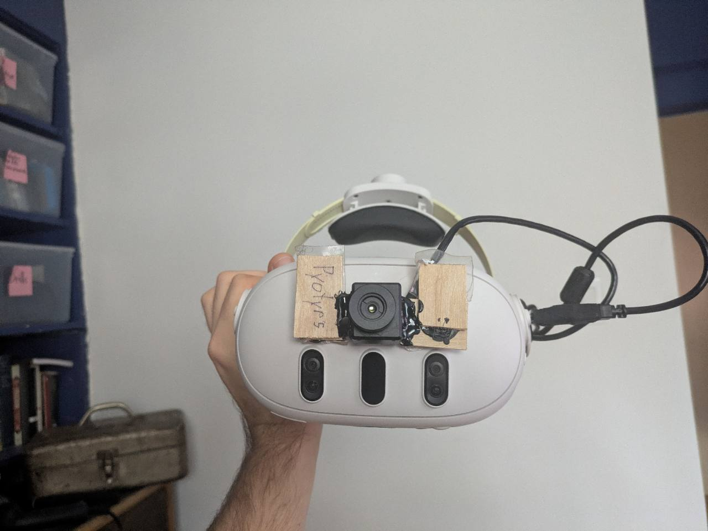

# Quest Thermal

A head-following thermal overlay for **Meta Quest 3**, by **Pyotyr**.

**Requires a compatible HIK-based USB thermal camera/module connected to the headset.** The tested module has a USB-A plug, connected to the Quest through a USB-C OTG adapter.
The Quest's built-in cameras do not capture thermal images.

[Download the APK](https://github.com/pyotyr/quest-thermal/releases/latest) · [Source and licence](LICENSE)

## Camera compatibility

Tested on a Meta Quest 3 with the **USB option** of the following FPV/UAV thermal-camera module listing, supplied by Pyotyr:

> FPV UAV Infrared Thermal Imager Lens HD 50FPS Frame Rate 256/384/640 High-resolution USB Interface Thermal Imaging

[Camera listing on AliExpress](https://www.aliexpress.com/item/1005010411514121.html) — select the **USB** option and the **256×192** resolution variant. The camera identifies through the HIK F2-compatible USB protocol. The listing title advertises several resolutions/frame rates; the mode below is what was actually observed and tested.

| Property | Tested value |
| --- | --- |
| USB vendor/product ID | `2BDF:0102` |
| Thermal image | 256 × 192 |
| Tested stacked UVC mode | 256 × 392, 25 fps, advertised as YUY2 |
| Camera connection | USB-A via a USB-C OTG adapter |
| Tested product variant | USB option; board/module shown below |

Compatibility depends on the camera's USB protocol and frame layout. Other modules, resolutions, connector variants and HIKMICRO retail models need testing. FLIR, Seek, InfiRay and generic webcams are not supported configurations for this release. This is an independent project, unaffiliated with HIKMICRO or Meta.

## Tested USB connection

**Thermal module → USB-A cable → USB-A female / USB-C male OTG adapter → Quest 3 USB-C port.**

Pyotyr used [this USB-A to USB-C adapter](https://www.amazon.ca/dp/B0B9N3QSL3) (Amazon ASIN `B0B9N3QSL3`) with the module's **USB** option linked above. Use a data-capable OTG adapter/cable. A charging-only connection will not carry the thermal feed. The camera occupies the headset's USB port during use; charging/hub arrangements have not been validated by this project.

## What it does

- Keeps a thermal overlay in front of your view as you turn your head, with passthrough behind it.
- Runs as a boundaryless mixed-reality app; no room setup is needed for image alignment.
- Supports curved or flat display, drag/corner resize, and four-point image alignment.
- Offers white-hot/black-cold grayscale with adaptive red hot and blue cold highlights, plus other colour maps.
- Controls grayscale, red, blue and overall transparency independently.
- Shows optional min/max/centre markers and relative mean heat; hides controls for a clean view.
- Uses the clean 16-bit plane on the tested camera, avoiding the camera preview's burned-in Max label and crosshair.
- Fades stale images and shows an animated **Camera calibrating or paused…** indicator when frames stop changing.
- Appears in the tested camera's USB app chooser; choose **Always** if offered by Horizon OS.

## Install

1. Enable developer mode on the Quest and connect it to a computer with a USB data cable.
2. Approve USB debugging in the headset.
3. Download `Quest-Thermal-0.8.0.apk` from [Releases](https://github.com/pyotyr/quest-thermal/releases).
4. Sideload the APK using your usual installer or Android platform-tools:

   ```sh
   adb install -r Quest-Thermal-0.8.0.apk
   ```

5. Open **Quest Thermal** from the headset's Unknown Sources apps. Allow the camera/USB permissions requested by Horizon OS.
6. Disconnect the computer and connect the compatible thermal module through its USB-C OTG adapter to the headset's USB-C port. In the USB app chooser, select Quest Thermal.

The application ID is `io.pyotyr.questthermal`. The release APK uses the existing development signing key; updates preserve settings for compatible earlier Pyotyr builds. APKs built independently or by CI may use a different key and cannot update that installation directly.

## Controls and alignment

Tap the transparent image canvas to show the controls. **Hide controls** dismisses them; **Clean view** also hides marker/readout options.

**Drag / resize:** drag inside the outlined thermal image to move it, or drag a cyan corner to resize it around the opposite corner. Tap outside the outline to finish.

**Match 4 points:** keep the headset and camera steady. Select four well-spaced identifiable points in the frozen thermal image. The image then hides; select the matching real-world points in passthrough in the same order. The app saves a projective fit. Cancel exits without replacing the previous fit.

Alignment is approximate and is specific to the camera's mounting, orientation and one reference distance. Camera/headset separation causes parallax at other distances. Keep passthrough visible when moving; an opaque thermal overlay can obscure obstacles.

## Example mounting

Pyotyr mounted the USB thermal module above the Quest 3's front sensors on a small homemade plate, with the USB cable routed to the side port. These photographs show the working prototype and its adapter/cabling; the plate is not included with the app. Keep the headset's cameras and sensors unobstructed, and support the cable so it does not pull on the USB-C port.





Each mount needs its own alignment. The included preset comes from this setup.

## Included defaults

New installs use [Pyotyr's exported preset](defaults/pyotyr-preset.json), captured from the working headset on 26 November 2026:

| Setting | Default |
| --- | --- |
| Head following | On |
| Window | Curved |
| Overall opacity | 80% |
| Grayscale opacity | 86% |
| Red / blue opacity | 100% / 100% |
| Hot / cold tail | 1% / 13% of the scene distribution |
| Colour map | Grayscale + hot/cold |
| Contrast | Contrast-limited histogram |
| Minimum / maximum marker | Off / on |
| Centre / mean | Off / off |
| Camera rotation | 180° |

The preset includes Pyotyr's saved alignment matrix. Re-align it for your own camera mounting. Existing saved settings take precedence when updating. **Reset alignment** returns to a neutral starting geometry for adjustment.

## Measurement and calibration limits

The clean preview currently shows relative heat, not validated absolute Celsius/Fahrenheit measurements. The camera's Max text is intentionally excluded. The pause indicator infers missing or repeated image frames; it does not positively identify a shutter/FFC event and can also indicate a USB or stream interruption.

The clean sensor plane has less processing than HIKMICRO's preview, so image appearance can differ. Histogram amplification is limited to reduce noise in uniform surfaces.

## Build and test

Use JDK 17 or 21, Android SDK platform 34, and build-tools 35.0.0. Point `ANDROID_HOME` at your SDK, or create an untracked `local.properties` with `sdk.dir`.

```sh
./gradlew :app:assembleDebug :app:testDebugUnitTest :app:lintDebug
```

On Windows, use `gradlew.bat`. Output: `app/build/outputs/apk/debug/app-debug.apk`.

Version 0.8.0 passed 27 local tests and Android lint with zero errors. Coverage includes stacked sensor/annotated-preview separation, 16-bit gradients, pause/recovery and repeated frames, four-point fitting, drag/resize interactions, preset parity, and preservation of saved settings on upgrade. The public test frame is synthetic. Version 0.7's core viewer was also tried successfully on the physical Quest/camera setup; the new-install preset is covered locally. Hardware combinations beyond the tested setup remain unverified.

## Credits and licence

Adapted from [cfbird/HT203U-Thermal](https://github.com/cfbird/HT203U-Thermal), based on upstream commit `39ba7216e4e833e61e73a67146730a74a052fe20`. The original Android source namespace is retained for compatibility. See the [upstream README](docs/upstream-README.md).

Quest integration, alignment tools, viewer controls and the public preset are by Pyotyr. Project source is licensed under **GPL-3.0**; see [LICENSE](LICENSE). Meta Spatial SDK dependencies are obtained separately from Maven Central under their own terms. No HIKMICRO Viewer APK, proprietary camera SDK, or decompiled vendor source is distributed in this repository.
