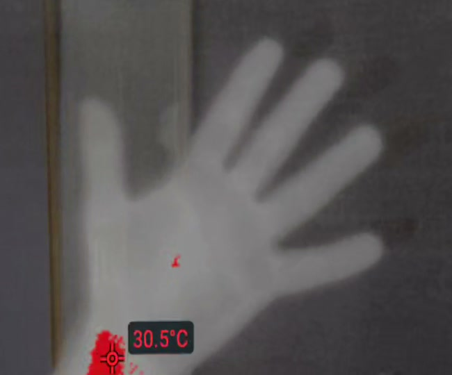
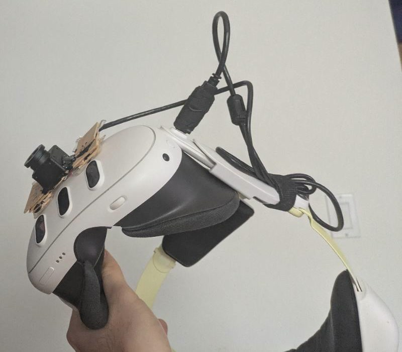
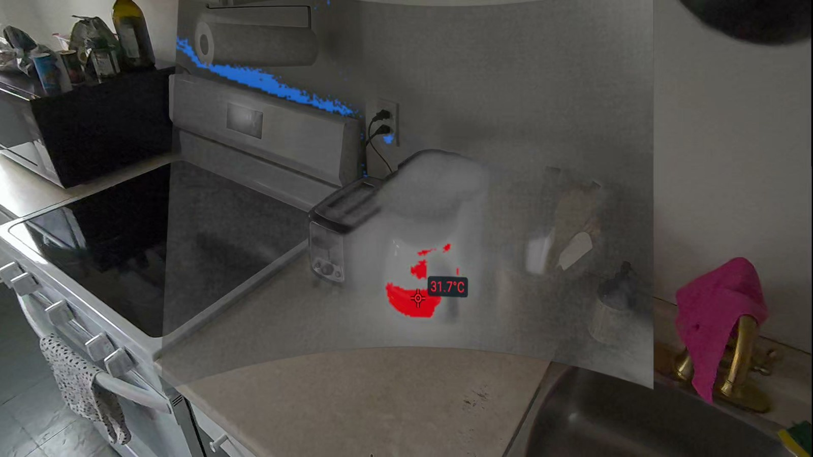
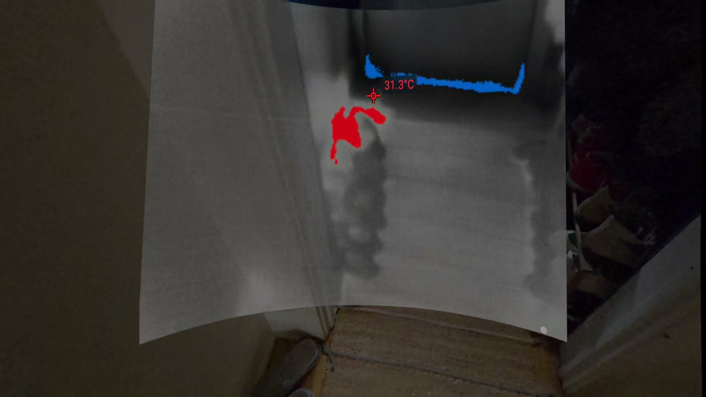
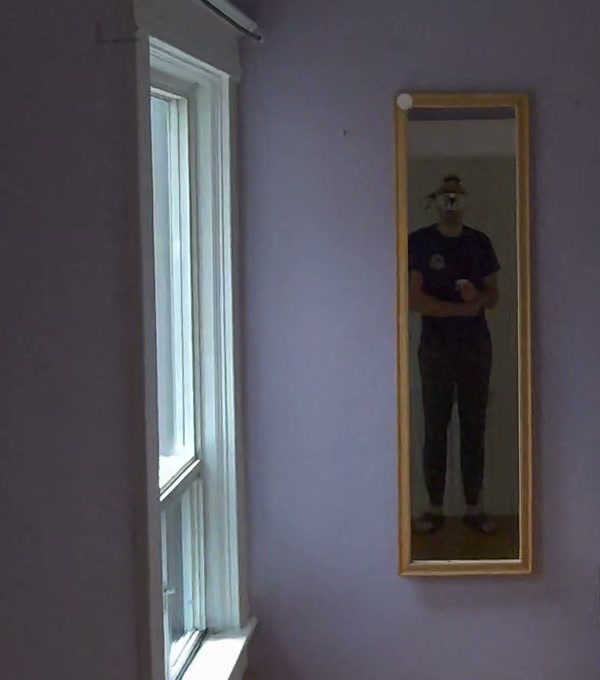
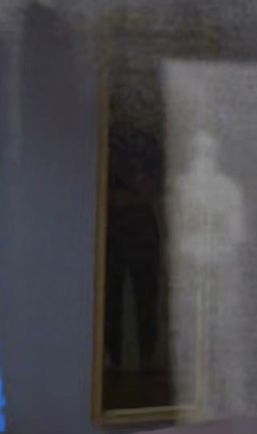
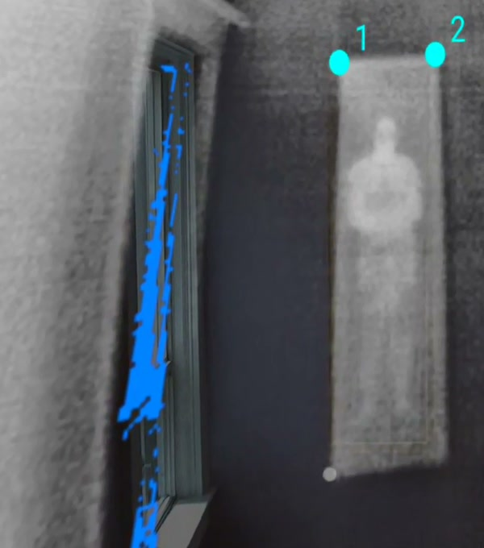

# Quest Thermal in use

Real headset captures from Pyotyr's Meta Quest 3 and 256×192 USB thermal module, taken on 26 November 2026 with v0.8.2. Images are cropped and resized to focus on the demonstration; the thermal content and alignment have not been retouched.

[Download the APK](https://github.com/pyotyr/quest-thermal/releases/latest) · [Hardware and setup](../README.md#camera-compatibility)

## Wearing the thermal-equipped headset

Pyotyr wearing the thermal-equipped Quest 3: the mirror view shows the physical setup, thermal contrast, and the camera-reported maximum temperature together with ordinary colour passthrough.

## Your hand in thermal passthrough

An open hand stands out in white-hot grayscale, with a warmer region near the wrist highlighted in red. The red crosshair shows the camera-reported maximum of 30.5°C in this scene.

## How the camera is mounted

The thermal module sits above the Quest's front sensors on a homemade plate made from popsicle sticks, hot glue and double-sided/gel tape. Placing its lens close to the Quest's passthrough cameras reduces parallax. The USB-A camera connects to the headset through a USB-C OTG adapter. See [the mounting notes and side view](../README.md#example-mounting).

## Warm electronics beside a cooler window

The routers stand out against the surrounding window and wall. A floor vent is also visible in front of the window, showing electronics and a heating vent in the same view. The image combines white-hot/black-cold grayscale with adaptive red hot and blue cold highlights.

## Kitchen appliances

Compare warmer objects around the kitchen with the ordinary colour view still visible behind the overlay.

## Floor vent beside the door

The floor vent is beside the door, on the left side of this view. The wider view shows its position relative to the doorway and surrounding floor, with the thermal overlay blended over passthrough.

## Normal passthrough in the mirror

The thermal image is hidden during the passthrough stage of alignment, making it possible to select real-world reference points.

## Why four-point alignment matters

Here the thermal mirror is visibly offset from the mirror in passthrough. This illustrates why the overlay needs four-point alignment: select four matching landmarks in the thermal and visible views to fit the image to the surroundings. This is a misalignment example, not a demonstration of a finished alignment. The fit remains approximate and depends on distance because the thermal and Quest cameras occupy different positions.

## Four-point alignment: thermal landmarks

Choose four well-spaced landmarks in the frozen thermal image. The numbered cyan points show the selections in progress.

## Four-point alignment: passthrough landmarks

The thermal image hides while you choose the corresponding points in passthrough. The saved fit can be adjusted for the camera's position; parallax means it will not perfectly match objects at every distance.

## Reading the images

Red and blue mark the hot and cold tails of the current scene's distribution. They are not fixed Celsius bands. The red crosshair's number is the camera-reported maximum on the tested USB mode. Image alignment, temperature accuracy and reflections depend on the setup and scene; see [measurement and calibration limits](../README.md#measurement-and-calibration-limits).

Warm highlights at the image corners may be influenced by the headset or camera mount; their cause has not been isolated. They should not be interpreted as vents or other room features.
