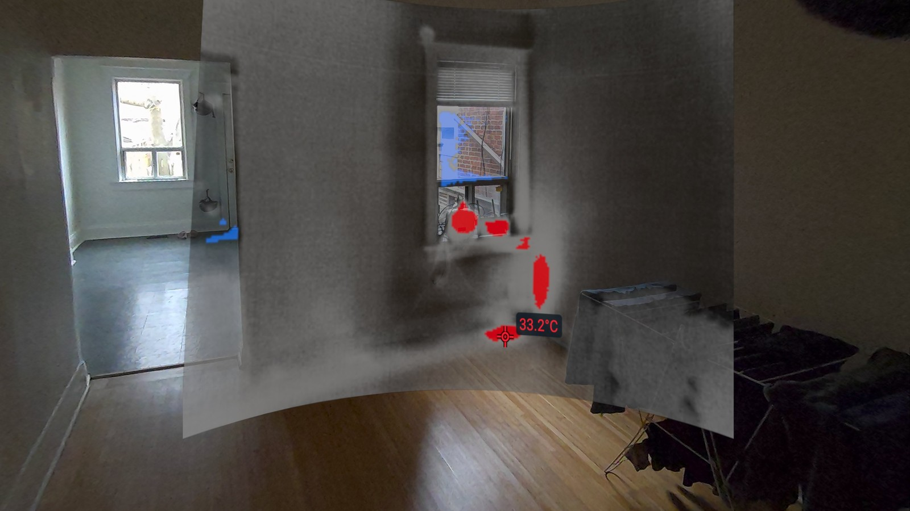
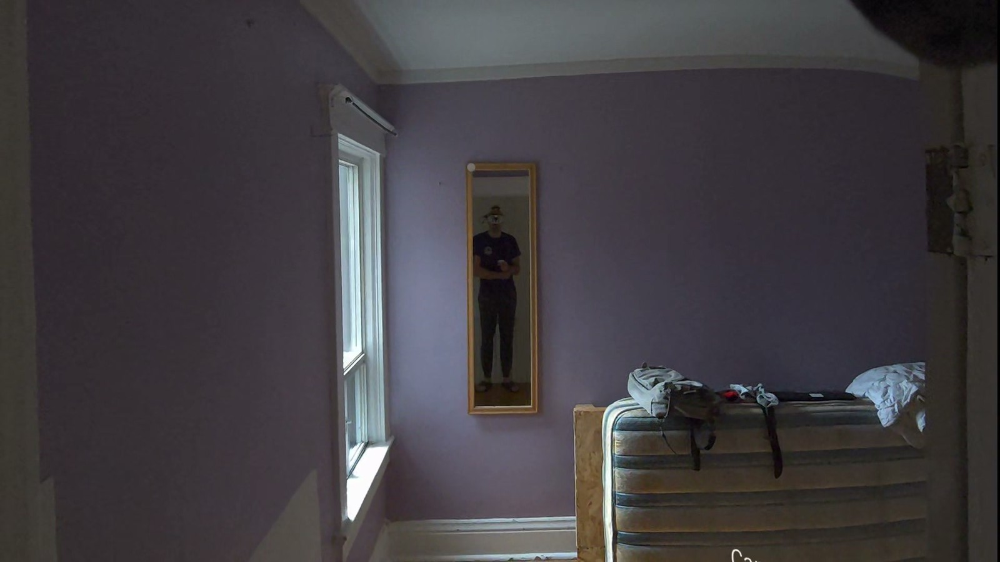
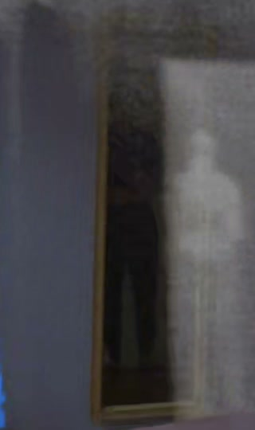
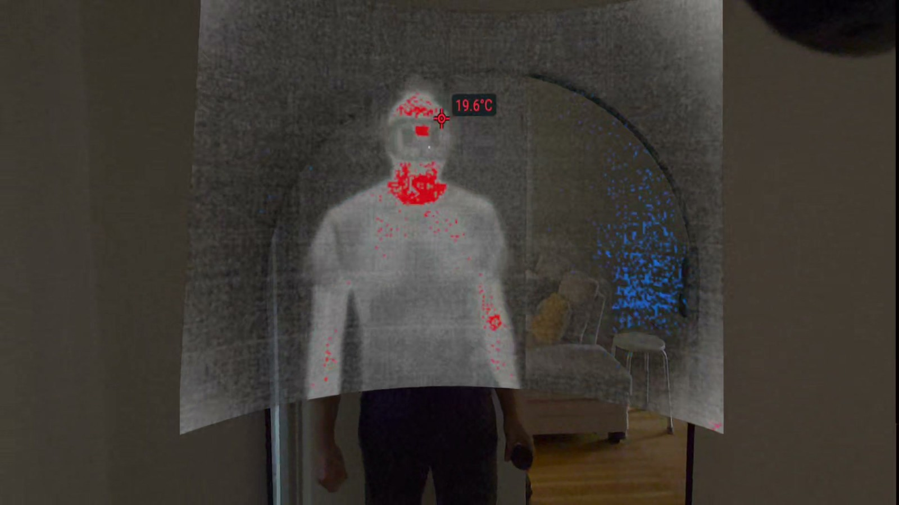
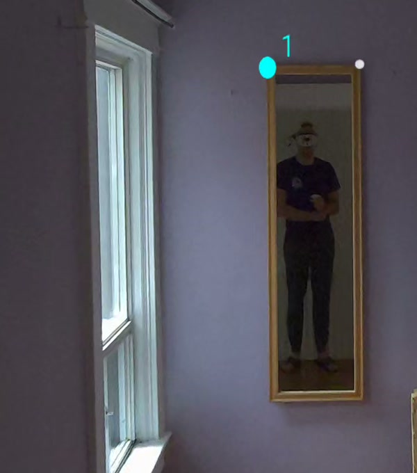
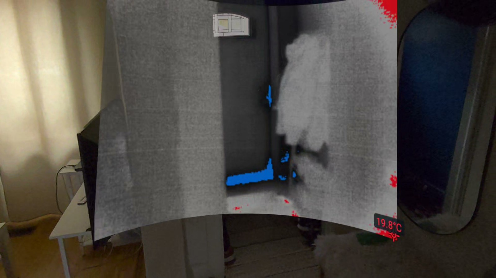

# Quest Thermal in use

Real headset captures from Pyotyr's Meta Quest 3 and 256×192 USB thermal module, taken on 26 November 2026 with v0.8.2. Images are cropped and resized to focus on the demonstration; the thermal content and alignment have not been retouched.

[Download the APK](https://github.com/pyotyr/quest-thermal/releases/latest) · [Hardware and setup](../README.md#camera-compatibility)

## Warm electronics beside a cooler window

The routers stand out against the surrounding window and wall. The image combines white-hot/black-cold grayscale with adaptive red hot and blue cold highlights.

## Kitchen appliances

Compare warmer objects around the kitchen with the ordinary colour view still visible behind the overlay.

## Normal passthrough in the mirror

The thermal image is hidden during the passthrough stage of alignment, making it possible to select real-world reference points.

## Thermal overlay in the mirror

The thermal panel overlays the same room after switching back from the passthrough alignment stage.

A closer mirror view shows the head-mounted setup in use, with thermal and visible imagery together.

## Four-point alignment: thermal landmarks

Choose four well-spaced landmarks in the frozen thermal image. The numbered cyan points show the selections in progress.

## Four-point alignment: passthrough landmarks

The thermal image hides while you choose the corresponding points in passthrough. The saved fit can be adjusted for the camera's position; parallax means it will not perfectly match objects at every distance.

## Vents and nearby surfaces

Explore temperature contrast while the curved panel follows your view.

## Reading the images

Red and blue mark the hot and cold tails of the current scene's distribution. They are not fixed Celsius bands. The red crosshair's number is the camera-reported maximum on the tested USB mode. Image alignment, temperature accuracy and reflections depend on the setup and scene; see [measurement and calibration limits](../README.md#measurement-and-calibration-limits).
